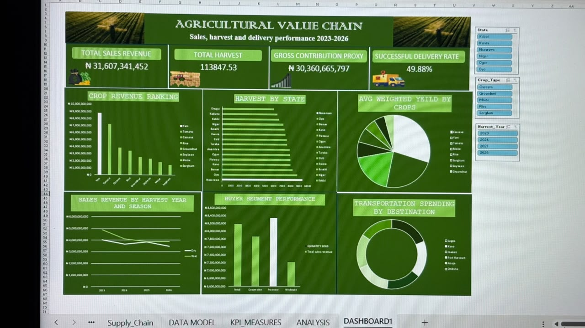

# Verdant Harvest Agric Business: Farm-to-Buyer Performance Analysis

An Excel Data Model, DAX and dashboard project that turns 10,000 farm, sales and delivery records into clear business decisions.
*EXCEL Group Data Analytics Capstone, 2026*

## 1. Project in Plain English

Verdant Harvest is a **fictional** Nigerian agribusiness. It helps 2,500 smallholder farmers across 15 states grow crops, sell them to buyers, and deliver them to six cities. The company keeps lots of records but had no single view showing whether harvests turn into money, whether deliveries arrive, and where it should act first.

Think of it as three questions: **What do we grow? What do we earn? Do deliveries arrive?** This project answers all three on one dashboard.

## 2. Key Findings

| Question | Answer | What it means |
|---|---|---|
| Which crop is harvested most? | Cassava (about 34,800 tonnes) | Cassava is also the most productive per hectare of land |
| Which crop earns most? | Yam (about ₦8.78 billion) | Growing the most is not the same as earning the most |
| Total sales | About ₦31.61 billion | Across 2,500 sales records, 2023 to 2026 |
| Top state by harvest | Nasarawa (about 9,389 tonnes) | Best place to focus support and planning |
| Top buyer type | Processor (₦8.34B), narrowly ahead of Retail (₦8.18B) | Revenue is fairly evenly spread across the four buyer types |
| Do deliveries arrive? | Delivered 32.9%, Delayed 33.1%, In Transit 34.0% | Of completed deliveries, only about half (49.9%) were successful. This is the biggest area to investigate |

## 3. How I Did It

- **Prepare:** Imported four tables (Farmers, Crop Production, Agricultural Sales, Supply Chain) into Excel, checked for blanks, duplicates, spelling and date errors, and verified that every ID links correctly.
- **Model:** Loaded the tables into the Excel Data Model with one-to-many relationships and wrote 12 DAX measures (for example Total Sales Revenue, Weighted Yield, Transport Cost per Tonne).
- **Analyse:** Built six PivotTables (crop, state, yield, season, buyer, city) and compared 2023 with 2026.
- **Present:** Built an interactive dashboard with four KPIs, six Pivot Charts and three slicers, then turned the findings into prioritised actions.
